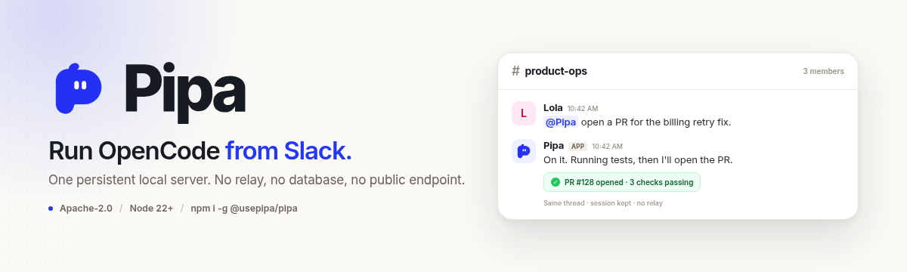

<p align="center">
  <a href="https://www.usepipa.com/opencode-slack?utm_source=github&utm_medium=repo_readme&utm_campaign=signup&utm_content=readme_banner">
    
  </a>
</p>

<p align="center">
  <a href="https://github.com/lunchpaillola/pipa/actions/workflows/ci.yml"></a>
  <a href="https://www.npmjs.com/package/@usepipa/pipa"></a>
</p>

<p align="center">
  <strong>Pipa turns a Slack thread into a durable OpenCode session on one private server, local by default.</strong><br>
  No relay, no database, no public endpoint.
</p>

<p align="center">
  <a href="https://www.youtube.com/watch?v=rlTMdkPWPcA"><strong>Watch the 3-minute setup</strong></a>
  ·
  <a href="https://www.usepipa.com/opencode-slack?utm_source=github&utm_medium=repo_readme&utm_campaign=signup&utm_content=readme_how_it_works">How it works</a>
  ·
  <a href="CONTRIBUTING.md">Contributing</a>
  ·
  <a href="https://github.com/lunchpaillola/pipa/issues">Issues</a>
</p>

> **Early preview.** Features may break unintentionally, and CLI commands, configuration, and Slack behavior may continue to change.

## Why Pipa

| What it does | What that means |
| --- | --- |
| **One server** | In local mode, Pipa starts one private OpenCode server on `127.0.0.1` and reuses it for every Slack turn. Attached servers follow their own network controls. |
| **Thread sessions** | A mention starts a session; replies in that thread continue it. Different threads run independently, and a newer message interrupts only its own thread. |
| **Routines** | Schedule timezone-aware work that runs through the same agent and delivers to an exact channel or thread. |
| **Generated files** | In local mode, long work returns as a concise summary with generated files from a private per-turn directory. Attached non-loopback servers return inline text. |
| **Access control** | Restrict by Slack channel, human user, and bot. Allowlists are rechecked on every turn, interaction, and delivery. |
| **Restart** | `pipa restart` hands off to a detached worker and reports a durable status. |

If Pipa is useful, [star the repo](https://github.com/lunchpaillola/pipa).

## Quickstart

**Runs on** macOS, Linux, and Windows. **Requires** Node.js 22 or newer, [OpenCode](https://opencode.ai) installed and authenticated, and a Slack workspace where you can create an app.

```sh
npm install --global @usepipa/pipa
pipa init
pipa start
```

`pipa init` creates the Slack app manifest, opens the install flow, and saves the profile under `~/.pipa`. Invite Pipa to a channel and mention it. The [3-minute setup video](https://www.youtube.com/watch?v=rlTMdkPWPcA) shows the flow, and the [OpenCode Slack integration guide](https://www.usepipa.com/opencode-slack?utm_source=github&utm_medium=repo_readme&utm_campaign=signup&utm_content=readme_install_guide) is the current written path.

## Security model

In local mode, Pipa runs on your machine, not behind a relay. The local OpenCode server binds to `127.0.0.1` on an operating-system-assigned port; attached servers follow their own network controls. Slack access is limited by channel, user, and bot allowlists, rechecked on every turn. Tokens stay in the local profile with private file permissions, and OpenCode manages provider credentials.

Read [SECURITY.md](SECURITY.md) for the full model and reporting path.

## Pipa Managed

Want Lunch Pail Labs to configure, run, and manage agent workflows for your company? Check out [Pipa Managed](https://usepipa.com/managed?utm_source=github&utm_medium=repo_readme&utm_campaign=signup&utm_content=readme_footer). We set up a Slack-native operations agent for your team, then keep the workflows running.

## Local Socket Mode

Profiles created by `pipa init` use Socket Mode. Profiles written before mode support continue to load as Socket Mode.

### Requirements

- Node.js 22 or newer
- [OpenCode](https://opencode.ai) installed and authenticated
- A Slack workspace where you can create an app

Invite the Slack app only to channels whose members may use OpenCode in the configured working directory.

### Install

1. Install Pipa:

```sh
npm install --global @usepipa/pipa
```

2. From the folder where you want Pipa to work, run:

```sh
pipa init
```

`pipa init` guides you through creating and installing the Slack app and saving its local configuration. The generated manifest includes `channels:read`, `assistant:write`, and `commands`, plus a slash command derived from your configured bot name (`Chopper` gets `/chopper`) and a `/pipa` compatibility alias. For `Pipa`, these are the same command and appear only once. Review the alias collision guidance below before installing multiple apps in one workspace. Known missing scopes produce upgrade guidance without blocking startup.

3. Start Pipa:

```sh
pipa start
```

Keep `pipa start` running, invite Pipa to a trusted public or private Slack channel, and mention it there. In owned local mode, Pipa starts one OpenCode server bound to `127.0.0.1` on an operating-system-assigned port and reuses it for every Slack turn. Port `0` asks the operating system for an available port; no port configuration is required. Pipa replies in a thread, and follow-up messages in that thread reuse the same OpenCode session without another mention. A newer follow-up interrupts an active turn in the same thread, while other threads continue independently. While a turn is active, Pipa shows a typing status in its Slack thread.

Pipa keeps naturally short answers inline. For deeper work, OpenCode can return a concise summary with suitable generated files, such as documents, spreadsheets, PDFs, or images. Files are read only from a private session directory under `.pipa/artifacts` in the configured working directory. The directory is cleared before each turn, files are validated and limited to 10 files and 100 MB total, and the directory is deleted locally after delivery. If file delivery fails, Pipa retries the declaration-free summary without the files. Attached OpenCode servers on non-loopback hosts use inline text fallback instead of local artifact delivery.

Incoming messages can include up to Slack's 10-file limit, with a maximum size of 100 MB per file. Attachments require a text prompt and are copied to a temporary directory only for the duration of the turn.

### Access control

By default Pipa answers any human user who mentions it in a channel it can see, excluding DMs and external channels. In a shared workspace, restrict who can use it by listing the allowed Slack channel and user IDs. `pipa init` asks for these, and they are stored in the config:

```json
{
  "botName": "Pipa",
  "workingDirectory": "/work",
  "slackAppToken": "xapp-...",
  "slackBotToken": "xoxb-...",
  "allowedSlackChannelIds": ["C0BSE2JTYPR"],
  "allowedSlackUserIds": ["UFWBSCZ54"],
  "allowedSlackBotIds": ["B0C6Q27E82X"]
}
```

A human user's mention is only handled when the channel and user pass their respective allowlists. An absent or empty `allowedSlackChannelIds` allows any otherwise eligible channel; an absent or empty `allowedSlackUserIds` allows any human user. You can also set them non-interactively during setup with `PIPA_ALLOWED_CHANNEL_IDS` and `PIPA_ALLOWED_USER_IDS` (comma-separated).

By default Pipa ignores messages sent by other Slack apps. Unlike the human user and channel lists, an absent or empty `allowedSlackBotIds` disables all other bots. List their bot IDs to let those messages through; an allowed bot only needs its bot ID (e.g. `B0C6Q27E82X`), not an entry in `allowedSlackUserIds`. Bots still must pass the channel allowlist. Bots not on the list stay ignored even when `allowedSlackUserIds` is empty. Set it non-interactively during setup with `PIPA_ALLOWED_BOT_IDS` (comma-separated).

#### Find the sender's bot ID

Use the message event's `bot_id` (`B…`), not the app ID (`A…`) or bot user ID (`U…`). To look up the sender app's OAuth bot ID:

1. Open the **sender app** at [Slack Apps](https://api.slack.com/apps), not Pipa's app.
2. Under **OAuth & Permissions**, copy its **Bot User OAuth Token** (`xoxb-…`). If needed, install the app in the workspace via **Install App** first.
3. Set that token locally in `SLACK_SENDER_BOT_TOKEN`, then call [Slack `auth.test`](https://docs.slack.dev/reference/methods/auth.test/):

```sh
curl --silent --show-error --request POST \
  --header "Authorization: Bearer ${SLACK_SENDER_BOT_TOKEN}" \
  https://slack.com/api/auth.test
```

No Slack CLI is needed. Keep the token out of config examples, shared output, and commits. A successful response includes fields like:

```json
{
  "ok": true,
  "user_id": "U0123456789",
  "bot_id": "B0123456789"
}
```

Use `bot_id` (`B0123456789`) in `allowedSlackBotIds`; `user_id` identifies the bot's user account and is not the bot allowlist ID.

**Incoming webhooks:** the posted message's `bot_id` can differ from the sender app's OAuth `bot_id` returned by `auth.test`. Allow the actual incoming message/event's `bot_id`. If you do not have the event payload, find the posted message with [Slack `conversations.history`](https://docs.slack.dev/reference/methods/conversations.history/) (or [`conversations.replies`](https://docs.slack.dev/reference/methods/conversations.replies/) for a thread reply), using a token with access to that conversation and the required history scope, and read its `bot_id`.

After saving the config, restart Pipa to load the updated allowlist. The allowed bot can start a conversation by posting `<@PIPA_BOT_USER_ID> triage this alert` in an allowed channel, or continue one by replying in a thread Pipa has subscribed to. For an incoming webhook, send that mention in the payload's `text` field. Allowlisting a bot does not make Pipa handle every message it posts in the channel; the normal mention/thread routing still applies. Only allow bots whose messages you trust as requests to your agent.

To use an existing OpenCode server instead, set its URL before starting Pipa. Pipa checks that the server can serve the configured workspace but does not start or stop it. If the server uses authentication, also set `OPENCODE_SERVER_USERNAME` and `OPENCODE_SERVER_PASSWORD`:

```sh
export PIPA_OPENCODE_ATTACH_URL=http://localhost:5555
pipa start
```

### Choosing a model

Type your installation's command followed by `model` in an allowed Slack channel: `/chopper model` for `Chopper`, `/pipwick model` for `Pipwick`, or the `/pipa model` compatibility alias when registered to that app. Both forms use the same private native modal, authorization checks, and setting. A loading window opens before catalog discovery, then fills with models grouped by provider. Browse or type to filter, choose a model, and Save. Save closes the window promptly; a private channel message confirms success only after fresh validation and persistence, or explains a failure. Wait for that confirmation before testing the new selection. Cancel leaves the setting unchanged. Existing channel and human-user allowlists are rechecked after discovery, on Save, during persistence, and before delivering the private result.

The command is computed from your configured `botName`, not a hardcoded list of bot names. Pipa decomposes accented Latin characters, removes combining marks, lowercases the name, replaces runs of spaces/punctuation/other non-ASCII characters with `-`, trims edge hyphens, and limits the part after `/` to 31 characters (trimming any resulting trailing hyphen). For example, `Workshop "Bot"` becomes `/workshop-bot` and `Café 🧪` becomes `/cafe`. A valid display name with no usable ASCII slug, such as `🤖` or `東京`, falls back to `/pipa` so this optional feature cannot prevent an old profile from starting. Existing display-name validation still applies. Generated commands use a conservative lowercase-letter/digit/hyphen subset within Slack's 32-character limit including `/`.

**Alias collision:** [Slack slash commands are not namespaced](https://docs.slack.dev/interactivity/implementing-slash-commands/#naming_your_command). If multiple apps register `/pipa`, Slack routes it to the most recently installed app; Pipa cannot redirect it to another installation. In a multi-app workspace, keep distinct named commands and omit the generic alias from other apps' Slack manifests, or assign `/pipa` to exactly one app. Fallback-only installations also share `/pipa`; use a name with an ASCII slug if you need a distinct command. Check the installation name shown in the modal before saving. Case, punctuation, or truncation can also make different names normalize identically; choose distinct resulting names.

The default for new threads is stored as optional `defaultModel: { "providerID": "openai", "modelID": "your-model-id" }` in the existing `.pipa/config.json`. It takes effect without restarting Pipa. Existing threads keep the model recorded in their OpenCode conversation history, including across restarts, so different threads can use different models. New or empty sessions use the current default; when unset, OpenCode chooses its default. If a saved OpenCode session is no longer available, its replacement is a new session and uses the current default. This setting does not select models for separate subagents or external clients.

New routines snapshot the selection when created; preview JSON shows that snapshot. Existing routines and their saved model are unchanged by later saves or routine edits. A routine with no saved model uses OpenCode's default, never the current installation setting. Human replies to routine results retain the model recorded in that conversation. If a thread's provider stops working, reconnect it or choose a different default and start a new thread.

The picker preloads the configured OpenCode model catalog into a native Slack dropdown, grouped by provider. Open the dropdown to browse immediately, or type to filter models; no search callback is needed. Groups contain up to 100 models each, with at most 100 groups. Empty catalogs or catalogs exceeding Slack's limits get a private explanation instead of an empty or truncated list. A listed model may still lack credentials or quota; saving never runs inference to check it. The provider shown beneath each result identifies the connection: `opencode` and `openai` use separate credentials, even for similarly named models. Turn failures identify the provider and HTTP status when available; authentication failures give reconnection guidance, and an explicitly expired API key is reported as expired. Raw upstream errors and credentials are not posted, and Pipa never silently switches models. Abandoned pickers expire after 30 minutes; reopen your installation's model command to continue.

If the model window cannot open, its private error distinguishes saved-settings problems, model-catalog loading, configured access restrictions, and Slack window failures. It confirms that the saved model is unchanged; it does not expose raw upstream errors or credentials.

### Upgrading an existing installation

**An npm upgrade updates local code only. It does not update the installed Slack app, register commands, or grant scopes.** Existing mentions and thread replies still work without model-command registration. Do not rerun `pipa init` or replace credentials to add this feature.

After `0.5.5` is published, use the same `PIPA_HOME` as your existing installation (leave it unset for the default `~/.pipa` profile):

```sh
npm install --global @usepipa/pipa@0.5.5
pipa --version
pipa manifest > "$HOME/pipa-slack-manifest-0.5.5.json"
```

`pipa manifest` reads the existing profile and prints the current **local template** without tokens. It does not write config, sessions, routines, or the cached manifest, call Slack, or run inference. It is not an export of your app's current remote/custom configuration.

1. Open your **existing app** in [Slack App Management](https://api.slack.com/apps). Keep a copy of its current remote manifest.
2. In **App Manifest**, merge the generated `features.slash_commands` entries you want (the named command and optionally `/pipa`) and add `commands` to `oauth_config.scopes.bot`. Preserve unrelated remote settings, existing commands, scopes, Socket Mode, and interactivity. **Do not replace a customized remote manifest wholesale with the local template.** Alternatively, add the matching commands under **Slash Commands** and add the bot scope under **OAuth & Permissions**.
3. Save, then reinstall or reauthorize that same app. Retain your current tokens unless Slack rotates them; if it does, update the existing local config securely rather than reinitializing the profile.
4. Restart the same profile to load the upgraded runtime:

```sh
pipa restart
pipa restart --status
```

Restart reports **requested** first; inspect status for completion. Then try `/chopper model` (for configured `Chopper`) and `/pipa model` if the alias is registered to that app. Merely recognizing an alias in Pipa cannot bypass missing Slack registration. A known missing `commands` scope produces a warning at startup; scope metadata alone cannot verify command registration, and an absent warning does not prove it is installed.

Before npm publication, preview the feature branch from this repo without reinstalling or reinitializing your profile:

```sh
npm ci
node bin/pipa.mjs --version
node bin/pipa.mjs manifest > "$HOME/pipa-slack-manifest-preview.json"
```

For running the unpublished branch, use the separate test app/profile procedure in `CONTRIBUTING.md`; do not start a second Socket listener with a running installation's credentials. Renaming an app/bot in Slack alone does not update command registration or Pipa's local `botName`. A local name change needs matching Slack registration and an installation restart.

### Routines

Local Pipa can save timezone-aware work that runs through the same OpenCode agent and delivers to one exact Slack channel or existing thread. Replies to a routine result continue the OpenCode session that produced it. Routines use the configured working directory, tools, permissions, channel allowlist, and responder allowlist.

Preview agent-assisted changes first, inspect the normalized JSON, then create only after confirmation:

```sh
pipa routine create \
  --prompt "Send the daily brief" \
  --timezone America/New_York \
  --channel C0BSE2JTYPR \
  --every 1d \
  --times 05:00 \
  --preview \
  --json
```

Remove `--preview` to save the routine. Use `--prompt-file` when exact multiline text or shell-like characters must be preserved. Timezones must be IANA names such as `America/New_York` or `UTC`; aliases such as `EST` are not accepted.

Supported schedules:

```sh
# Every 30 minutes
pipa routine create --prompt "Check the queue" --timezone UTC --channel C0BSE2JTYPR --every 30m

# Once, five minutes from the CLI clock
pipa routine create --prompt "Follow up" --timezone UTC --channel C0BSE2JTYPR --in 5m

# Tuesday, Thursday, and Saturday at three local times
pipa routine create --prompt "Post status" --timezone America/New_York --channel C0BSE2JTYPR --every 1w --weekdays 2,4,6 --times 09:00,15:00,18:00

# Daily through the inclusive local date September 5
pipa routine create --prompt "Evening close" --timezone America/New_York --channel C0BSE2JTYPR --every 1d --times 19:00 --until 2030-09-05
```

Use `pipa routine list`, `show`, `edit`, `run`, and `delete` for the lifecycle. Deactivate or reactivate with `edit --status inactive|active`. Completed one-time and final recurring routines remain inspectable until deleted. `routine run` requests one execution without changing the saved schedule or status.

Routines run only while the Socket Mode `pipa start` process is running and the machine is awake. Restart skips missed scheduled occurrences instead of backfilling them. Explicit run requests survive restart, but can repeat if the process crashes after agent side effects or Slack delivery and before completion is saved. Managed profiles do not execute routines. Run `pipa routine --help` for the complete syntax and JSON contract.

### Restarting Pipa

Ask Pipa to restart, or run:

```sh
pipa restart
pipa restart --status
```

Anyone allowed by the existing Slack user and channel controls can request a restart; there is no separate restart approval. The first command reports **requested**, not completed. The read-only status command shows the latest request ID, state (`requested`, `running`, `completed`, `failed`, or `unconfirmed`), phase, and any failure guidance. An expired handoff is unconfirmed, never assumed successful. Private records under `.pipa/restarts` remain available after the initiating turn exits.

The running Pipa launches a detached worker before stopping intake, cleaning up, and releasing its instance lock. The worker waits for the original process and lock to disappear, then starts a detached replacement and confirms workspace readiness (and Slack readiness for Socket Mode). The replacement continues in the background without terminal output; use `pipa stop` to stop it. This works for Socket and Managed profiles on supported macOS, Linux, and Windows systems. Attached OpenCode servers remain externally owned and are never stopped by Pipa.

When a restart is requested from Slack, the bot reports that it is restarting and posts to the same thread after the replacement is ready. A manual stop instead reports that the bot will not respond until it starts again.

Do not chain `pipa stop` and `pipa start` inside an agent turn: stopping owned OpenCode also kills that turn. OpenCode's `/instance/dispose` disposes an instance; it does not restart the server.

Commands must use the same `PIPA_HOME` (the parent of `.pipa`) as the running profile. Pipa passes the resolved absolute home to its owned OpenCode and restart processes. With an attached server, ensure the agent's command environment uses that home; a remote server needs command access to the Pipa host. An older running Pipa needs one manual stop/start after upgrading. If status reports failure or an unconfirmed handoff, inspect the reported phase and current instance before attempting a manual start.

## Commands

```text
pipa init       Configure Slack and the local working directory
pipa start      Start the configured Slack runtime
pipa stop       Stop the running local Pipa process
pipa restart [--channel <id> [--thread <ts>]]  Request a detached restart
pipa restart --status  Inspect the latest durable restart outcome
pipa routine    Create and manage local scheduled routines
pipa manifest   Print the current local Slack manifest template for an existing profile
pipa --version  Print the installed version
```

## Development

```sh
npm ci
npm test
npm run test:pack
```

`npm run test:slack:routines` is a manual real-service smoke test. It requires a running local Socket Mode process plus `SLACK_USER_TOKEN`, `SLACK_TEST_CHANNEL_ID`, and `SLACK_PIPA_BOT_USER_ID`; it is not part of automatic CI.

See [CONTRIBUTING.md](CONTRIBUTING.md) before opening a pull request.

See the [repository overview](docs/repository-overview.md) for a file-by-file explanation of how Pipa works.

## Releases

Pipa follows [Semantic Versioning](https://semver.org/). Release notes are published on [GitHub Releases](https://github.com/lunchpaillola/pipa/releases).

## License

Licensed under the [Apache License 2.0](LICENSE).
