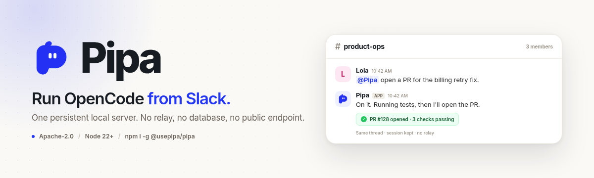

<p align="center">
  <a href="https://www.usepipa.com/opencode-slack?utm_source=github&utm_medium=repo_readme&utm_campaign=signup&utm_content=readme_banner">
    
  </a>
</p>

<p align="center">
  <a href="https://github.com/lunchpaillola/pipa/actions/workflows/ci.yml"></a>
  <a href="https://www.npmjs.com/package/@usepipa/pipa"></a>
</p>

<p align="center">
  <strong>Pipa turns OpenCode into a Slack agent. Start sessions and talk to OpenCode from Slack.</strong>
</p>

<p align="center">
  <a href="https://www.youtube.com/watch?v=rlTMdkPWPcA"><strong>Watch the four-minute setup video</strong></a>
  ·
  <a href="https://www.usepipa.com/opencode-slack?utm_source=github&utm_medium=repo_readme&utm_campaign=signup&utm_content=readme_how_it_works">How it works</a>
  ·
  <a href="CONTRIBUTING.md">Contributing</a>
  ·
  <a href="https://github.com/lunchpaillola/pipa/issues">Issues</a>
</p>

> **Early preview.** Features may break. Commands, configuration, and Slack behavior may change.

If Pipa is useful, [star the repo](https://github.com/lunchpaillola/pipa).

## Why Pipa

| What it does | What that means |
| --- | --- |
| **Thread sessions** | Mention Pipa to start a session. Reply in the thread to keep working. |
| **Routines** | Schedule work in your timezone. Send results to a channel or thread. |
| **Access control** | Choose which Slack channels, people, and bots can use Pipa. |

## Pipa Managed

Want Lunch Pail Labs to set up and run agent workflows for your team? See [Pipa Managed](https://usepipa.com/managed?utm_source=github&utm_medium=repo_readme&utm_campaign=signup&utm_content=readme_footer).

## Quickstart

**Runs on** macOS, Linux, and Windows. **Requires** Node.js 22 or newer, [OpenCode](https://opencode.ai) installed and authenticated, and a Slack workspace where you can create an app.

```sh
npm install --global @usepipa/pipa@0.6.0
pipa init
pipa start
```

`pipa init` walks you through Slack setup and saves your profile under `~/.pipa`. Invite Pipa to an allowed channel and mention it. Follow the [four-minute setup video](https://www.youtube.com/watch?v=rlTMdkPWPcA) or the [written tutorial](https://www.usepipa.com/opencode-slack?utm_source=github&utm_medium=repo_readme&utm_campaign=signup&utm_content=readme_install_guide).

### Install with your agent

Paste this into your coding agent on the computer where Pipa will run:

```text
Help me install Pipa Local. Check prerequisites and whether a Pipa profile
already exists. Inspect only non-secret configuration fields; never print or
return credentials in tool output or chat. Ask me to complete Slack
authentication and app setup myself; never ask me to paste tokens into chat.
For a new installation, follow https://www.usepipa.com/install. For an existing
profile, do not run pipa init: use the README's upgrade instructions, explain
the steps and ask me before making changes, and back up the profile first.
```

### OpenCode version selection

Pipa automatically detects OpenCode v1 or v2 and selects its native adapter. There is no manual Pipa migration command. OpenCode owns its data/schema upgrades; installing Pipa does not install or upgrade OpenCode.

Unversioned installs use npm's `latest` tag; `@beta` selects the beta channel. Before upgrading, stop/drain Pipa and back up its profile. Keep your current OpenCode version initially. Do not rerun `pipa init` or start a second listener. Read the [release notes](docs/release-0.6.0.md) for limits and rollback steps.

## Security model

Pipa runs locally by default. Its OpenCode server listens on `127.0.0.1`; attached servers use their own network controls. Slack allowlists control who can send requests. Empty channel and human-user lists allow everyone otherwise eligible. Other bots are blocked unless listed.

**The working directory is a starting location, not a sandbox.** Allowed users can ask the agent to use the OpenCode profile's tools and permissions beyond that directory. Set channel and user allowlists before sharing Pipa.

Slack tokens stay in the local profile with private file permissions. OpenCode manages provider credentials. Keep tokens, passwords, and local state out of shared output and commits.

Read [SECURITY.md](SECURITY.md) for security boundaries and reporting.

## Local Socket Mode

Socket Mode connects Pipa to Slack through an outbound connection. You do not need a public web endpoint.

### Install

1. Install Pipa:

```sh
npm install --global @usepipa/pipa@0.6.0
```

2. From the folder where you want Pipa to work, run:

```sh
pipa init
```

Follow the prompts to create and install the Slack app. Choose your working directory and set channel and user allowlists.

3. Start Pipa:

```sh
pipa start
```

Keep `pipa start` running. Invite Pipa to an allowed channel and mention it. Replies in that thread continue the same session without another mention. Different threads work independently.

On OpenCode v2, replies steer ongoing work, and background results can return to the thread. V1 interrupts the current turn when a new message arrives. Replies missed during a disconnect or restart are not recovered. After restart, send another message in the thread to resume background forwarding. Failed Slack deliveries are not replayed.

When you reply inside an existing Slack thread, Pipa reads preceding messages directly from Slack using its bot token, then sends that discussion plus your current request to OpenCode. No Composio connection is needed. New top-level mentions do not fetch history. History API reads are bounded to ten pages, 24 KiB of retained context, and 15 seconds; incomplete or unavailable history is identified in the prompt without a separate Slack warning. Old messages are quoted context, not fresh permission to act. Historical file contents and linked pages are not automatically downloaded. Repeated snapshots may overlap with the native conversation's existing history.

On v2, Pipa tries to continue the saved conversation normally. If OpenCode explicitly rejects the prompt because that session's working folder is missing, Pipa queues a native move to the configured starting folder, waits for the location to change, then resubmits that rejected request once. OpenCode owns active and queued work; Pipa does not veto, clear, or replay it. A short Slack heads-up is best-effort and never required for continuation. Missing files are not restored. Transport-uncertain requests are never automatically replayed. Startup, stop, and restart behavior are unchanged.

Startup waits for OpenCode and Slack to be ready, with no default overall timeout. Ctrl+C stops startup and processes Pipa owns, not attached servers. See [OpenCode compatibility](docs/opencode-compatibility.md) for startup, session, and upgrade details.

### Files

Include a text prompt with attachments. Incoming messages allow up to 10 files, each at most 10 MiB. Temporary copies are removed after the turn. Your model must support the files you send.

Generated files must stay inside Pipa's private artifact directory under `.pipa/artifacts`. Pipa checks paths, file identity, type, count, and size before sending them. Outgoing limits are 10 files and 100 MB per file or response. If file delivery fails, Pipa retries the summary without files. Attached servers on non-loopback hosts return inline text instead.

Attached v2 servers may need `BUN_JSC_maxRegExpStackSize=536870912` in the **server process** to handle large attachments. Pipa sets this by default for v2 servers it starts, unless overridden. See [attachment guidance](docs/opencode-compatibility.md) for details.

### Access control

By default, Pipa answers human users in channels it can see, excluding DMs and external channels. Use channel and user allowlists to restrict access. `pipa init` asks for these and saves them in the config:

```json
{
  "botName": "Pipa",
  "workingDirectory": "/work",
  "slackAppToken": "xapp-...",
  "slackBotToken": "xoxb-...",
  "allowedSlackChannelIds": ["C0BSE2JTYPR"],
  "allowedSlackUserIds": ["UFWBSCZ54"],
  "allowedSlackBotIds": ["B0C6Q27E82X"]
}
```

- Human requests must pass both the channel and user allowlists. Missing or empty lists allow all otherwise eligible channels or people.
- Other bots are blocked unless listed in `allowedSlackBotIds`. Use the sender's `bot_id` (`B…`), not its app ID (`A…`) or user ID (`U…`). Bots must pass the channel list but do not need a user-list entry.
- For scripted setup, use comma-separated `PIPA_ALLOWED_CHANNEL_IDS`, `PIPA_ALLOWED_USER_IDS`, and `PIPA_ALLOWED_BOT_IDS`.
- Restart Pipa after editing the config. Access is checked again for each turn, interaction, and delivery.

#### Mention-only mode

Set `mentionOnly` to `true` to require an @-mention for every turn, even in an existing thread:

```json
{
  "mentionOnly": true
}
```

`pipa init` asks for this. For scripted setup, use `PIPA_MENTION_ONLY` (`1`, `true`, or `yes`). Missing or `false` keeps thread-following on. Routines are unaffected.

#### Find the sender's bot ID

Open the **sender app** at [Slack Apps](https://api.slack.com/apps). Under **OAuth & Permissions**, get its installed Bot User OAuth Token. Set it locally in `SLACK_SENDER_BOT_TOKEN`, then call [Slack `auth.test`](https://docs.slack.dev/reference/methods/auth.test/):

```sh
curl --silent --show-error --request POST \
  --header "Authorization: Bearer ${SLACK_SENDER_BOT_TOKEN}" \
  https://slack.com/api/auth.test
```

Use the response's `bot_id` in `allowedSlackBotIds`. Keep the token out of config examples, shared output, and commits.

**Incoming webhooks:** use the posted message's actual `bot_id`; it may differ from `auth.test`. Read it from the event or [conversation history](https://docs.slack.dev/reference/methods/conversations.history/) with the required access and history scope.

Allowed bots still need to mention Pipa or reply in a subscribed thread. Webhooks must put the mention in `text`. Only allow bots whose messages you trust as agent requests.

### Use an existing OpenCode server

Set the server URL before starting Pipa. Pipa checks the workspace but does not start or stop that server. If it requires authentication, also set `OPENCODE_SERVER_USERNAME` and `OPENCODE_SERVER_PASSWORD`:

```sh
export PIPA_OPENCODE_ATTACH_URL=http://localhost:5555
pipa start
```

**External clients of a Managed profile:** set an explicit shared `OPENCODE_SERVER_PASSWORD` in the server/restart environment and every client. On v2, `OPENCODE_PASSWORD` takes precedence; match it or remove conflicting values. Otherwise Pipa generates a private password for each launch, and external clients cannot connect. Keep passwords private. See [OpenCode compatibility](docs/opencode-compatibility.md).

### Choosing a model

In an allowed channel, type your app's command followed by `model`: `/chopper model` for `Chopper`, or `/pipa model` when registered. Search by model name, ID, or provider. Choose a model, save, and wait for the private confirmation. Cancel leaves the setting unchanged.

The choice applies to new threads without restarting Pipa. Existing threads keep their model across replies and restarts. New routines save the current choice; existing routines keep theirs. Routines with no saved model use OpenCode's default. With no selection, new threads also use OpenCode's default. Changing this setting does not change subagents or external clients.

To use a different model from Slack, save your choice and start a new thread. The picker does not change existing threads.

The picker shows up to 100 matches; narrow your search for more. A listed model may still lack credentials or quota. Saving does not test it. Providers such as `opencode` and `openai` use separate credentials. If a provider fails, choose an available model and start a new thread, or ask your Pipa operator to reconnect it. [Connecting providers from Slack](https://github.com/lunchpaillola/pipa/issues/68) is a separate follow-up. Pipa never silently switches models.

**Multiple Slack apps:** give each a distinct command. Slack sends a shared `/pipa` command to the most recently installed app. Register that alias with only one app, and check the app name in the picker before saving.

### Upgrading an existing installation

**An npm upgrade does not update your Slack app, register commands, or grant scopes.** Mentions and thread replies still work without the model command. Do not rerun `pipa init` or replace credentials to add it.

After verified publication, stop/drain Pipa and privately back up its profile before upgrading to `0.6.0`. Keep the current OpenCode version and use the same `PIPA_HOME` as your existing installation (leave it unset for the default `~/.pipa` profile):

```sh
npm install --global @usepipa/pipa@0.6.0
pipa --version
pipa manifest > "$HOME/pipa-slack-manifest-0.6.0.json"
```

`pipa manifest` prints a local template without tokens. It does not change your profile or contact Slack. It is not an export of your app's current Slack settings.

1. Open your **existing app** in [Slack App Management](https://api.slack.com/apps). Back up its current manifest.
2. Merge the desired `features.slash_commands` entries and add `commands` to `oauth_config.scopes.bot`. Keep existing settings, commands, scopes, Socket Mode, and interactivity. **Do not replace a customized Slack manifest with the local template.**
3. Save and reinstall or reauthorize the same app. Keep your tokens unless Slack rotates them. If it does, update the existing local config securely.
4. Start the same stopped profile with its existing launch environment:

```sh
pipa start
```

Wait for readiness, then try the registered model command. The absence of a startup warning does not prove the command is installed. Renaming the bot in Slack does not update Pipa's `botName` or command registration; keep them aligned and restart.

To try an unpublished branch, follow the isolated test-app steps in [CONTRIBUTING.md](CONTRIBUTING.md). Never start a second Socket listener with a running installation's credentials.

### Routines

Routines run scheduled work and send results to a channel or existing thread. Replies continue that session. Routines use the profile's directory, tools, permissions, and allowlists.

Preview agent-assisted changes, check the JSON, and confirm before saving:

```sh
pipa routine create \
  --prompt "Send the daily brief" \
  --timezone America/New_York \
  --channel C0BSE2JTYPR \
  --every 1d \
  --times 05:00 \
  --preview \
  --json
```

Remove `--preview` to save. Use `--prompt-file` for exact multiline text or shell characters. Prompt files may be outside the starting folder; generated-file restrictions still apply. Use IANA timezones such as `America/New_York` or `UTC`, not `EST`.

Supported schedules:

```sh
# Every 30 minutes
pipa routine create --prompt "Check the queue" --timezone UTC --channel C0BSE2JTYPR --every 30m

# Once, five minutes from the CLI clock
pipa routine create --prompt "Follow up" --timezone UTC --channel C0BSE2JTYPR --in 5m

# Tuesday, Thursday, and Saturday at three local times
pipa routine create --prompt "Post status" --timezone America/New_York --channel C0BSE2JTYPR --every 1w --weekdays 2,4,6 --times 09:00,15:00,18:00
```

Use `pipa routine list`, `show`, `edit`, `run`, and `delete`. Pause or resume with `edit --status inactive|active`. Completed routines stay until deleted. `routine run` requests one execution without changing the schedule or status.

Routines need Socket Mode `pipa start` running and the machine awake. Missed scheduled runs are skipped. Explicit run requests survive restart, but a crash can cause repeated actions or deliveries. Managed profiles do not run routines. Use `pipa routine --help` for all options.

### Restarting Pipa

Ask Pipa to restart, or run:

```sh
pipa restart
pipa restart --status
```

Anyone allowed by Slack user and channel controls can request a restart. There is no separate approval. **Requested does not mean completed.** Check status; if failed or unconfirmed, inspect the reported phase and running instance before starting another process.

The replacement runs in the background. Use `pipa stop` to stop it. A Slack restart posts to the same thread when ready. Pipa never stops an attached OpenCode server. On Windows, `pipa stop` forcibly stops owned processes and can interrupt work; use `pipa restart` for a cooperative restart.

Do not chain `pipa stop` and `pipa start` inside an agent turn: stopping owned OpenCode kills that turn. OpenCode's `/instance/dispose` does not restart the server.

Use the running profile's `PIPA_HOME` (the parent of `.pipa`) for all commands. An attached server's agent needs that environment and command access to the Pipa host. Older running versions need one manual stop/start after upgrading.

## Commands

```text
pipa init       Configure Slack and the local working directory
pipa start      Start the configured Slack runtime
pipa stop       Stop the running local Pipa process
pipa restart [--channel <id> [--thread <ts>]]  Request a restart
pipa restart --status  Check the latest restart
pipa routine    Create and manage local scheduled routines
pipa manifest   Print the current local Slack manifest template for an existing profile
pipa --version  Print the installed version
```

## Development

```sh
npm ci
npm test
npm run test:pack
```

Read [CONTRIBUTING.md](CONTRIBUTING.md) before opening a PR. The [testing guide](docs/pipa-testing.md) covers real OpenCode and Slack checks, isolated test profiles, and cleanup. The [repository overview](docs/repository-overview.md) explains the code.

## Releases

Pipa follows [Semantic Versioning](https://semver.org/). Release notes are published on [GitHub Releases](https://github.com/lunchpaillola/pipa/releases).

## License

Licensed under the [Apache License 2.0](LICENSE).
