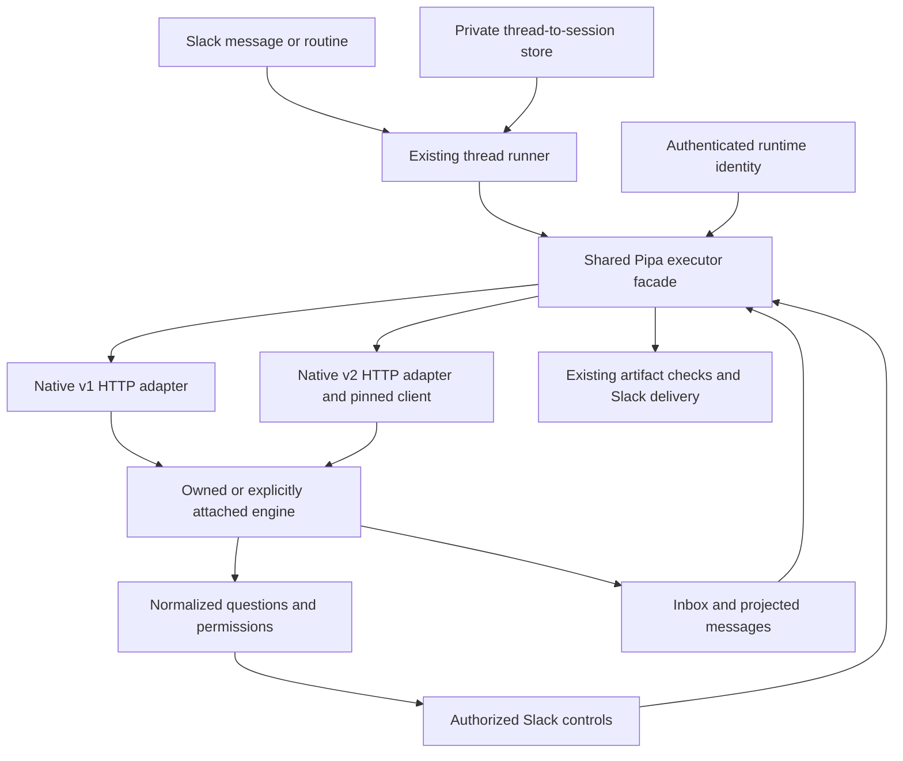
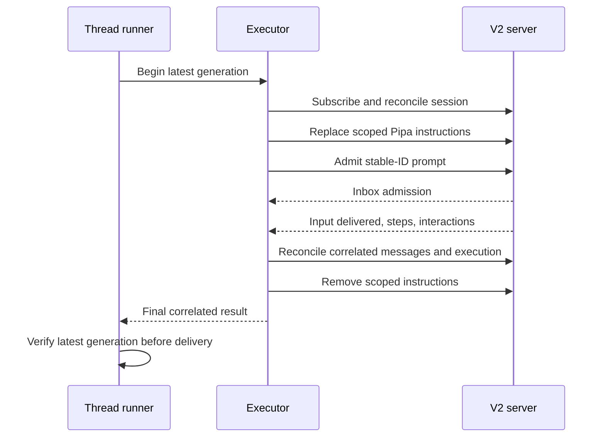
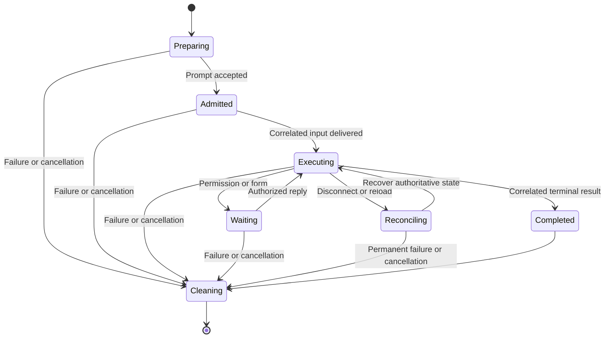
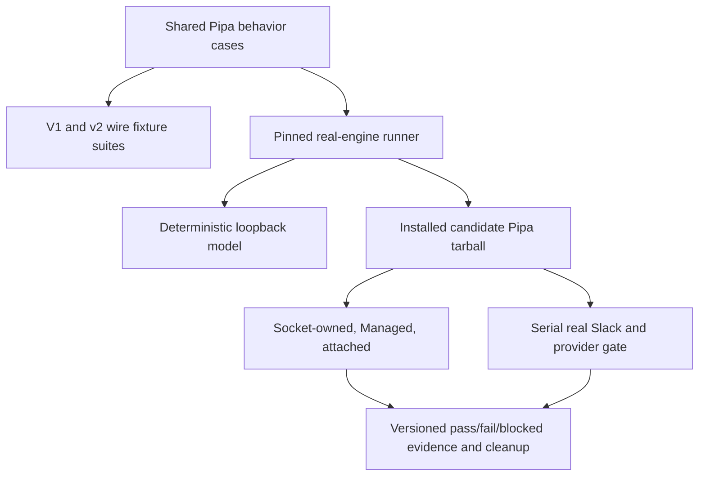

# OpenCode v1 and v2 Compatibility - Plan

**Target repository:** [lunchpaillola/pipa](https://github.com/lunchpaillola/pipa).
One Pipa package automatically selects a native v1 or v2 HTTP adapter. This plan is ready for local implementation, not a claim that the new runtime or harness already exists. Required release qualification and live deployment remain gated by the Verification Contract.

Product Contract preservation: R1 and R14 now cover both supported generations, superseding v2-only scope with the user's explicit approval. R2–R13 retain their behavioral intent; R12 distinguishes the v2-only live-model-switch capability. Existing R, AE, KTD, and U IDs remain stable.

## Goal Capsule

- **Objective:** Upgrading Pipa preserves existing Slack conversations, routines, approvals, and restart behavior whether the user has a supported OpenCode v1 or v2 installation.
- **Means:** One shared runtime facade with automatically selected native HTTP adapters and a reusable compatibility harness (KTD1, KTD11, KTD12).
- **Authority:** Product requirements govern behavior; technical decisions govern mechanisms; units implement both. Existing repository security and concurrency rules remain binding.
- **Execution profile:** Implement the shared contract/harness first, then version detection, adapters, and end-to-end verification. Keep execution progress outside this plan. Production rollout requires the Verification Contract.
- **Branch ownership:** Keep planning, harness, implementation, and verification changes on a new feature branch, `feat/opencode-v1-v2`; do not make the runtime change on `main`.
- **Stop conditions:** Unavailable required plugin; failed history migration; an attached server outside the configured workspace; ambiguous completion attribution; authentication or authorization regression; missing evidence for a mandatory verification case.
- **Tail ownership:** The implementation owner supplies verification evidence and migration instructions. Publishing, live installation, restart, and public PR creation require their own user instruction.

---

## Product Contract

### Summary

Support OpenCode v1 and v2 in one Pipa release, including owned and attached runtimes. Keep Slack, routines, restart, and delivery behavior shared; verify both adapters through the same feature contract and real-runtime harness.

### Problem Frame

Pipa currently requires OpenCode v1 during initialization and uses v1 HTTP payloads throughout execution. An OpenCode v2 upgrade breaks the unchanged executor. Requiring users to choose a matching Pipa release would move compatibility work onto them. The protocol spike demonstrated useful common ACP support but a v1 question gap and a different attached-server connection model; native HTTP adapters preserve the existing feature surface.

### Requirements

**Runtime and continuity**

- R1. One Pipa package automatically selects the v1 or v2 HTTP adapter from authenticated runtime identity and validated contracts in Socket-owned, Managed, and attached modes. Unsupported/missing runtimes fail with actionable guidance before Socket intake; no user adapter flag, global OpenCode replacement, or forced v1-to-v2 upgrade is introduced.
- R2. Previously persisted Slack thread mappings resume migrated sessions with history intact; failed migration must not silently create replacement sessions.
- R3. An owned server remains private and process-owned; an attached server is checked but never started, restarted, or killed by Pipa.
- R4. New messages supersede active same-thread work without stale output, state writes, or success reactions; other threads remain independent.

**Interactions and delivery**

- R5. Native v1 questions/permissions and v2 question forms/permissions appear in the correct Slack thread, including linked child requests, with existing responder authorization. Preserve the existing choice, multiselect, custom-answer, approval, and dismissal experience.
- R6. Reconnection or location reload reconciles pending controls and makes stale responses inert.
- R7. Slack context, routine/restart guidance, and artifact instructions reach the intended agent turn without leaking into another thread or a later turn.
- R8. Pipa accepts incoming files up to 10 MiB (10,485,760 bytes) each and rejects larger files with a clear message before prompt admission. Enforce the limit against both supplied size metadata and downloaded bytes; preserve the other incoming attachment behavior. User revision on 2026-10-15 supersedes the earlier 20 MiB decision after native boundary failure.
- R9. Preserve artifact containment, symlink and identity checks, 10-file/100 MB response limits, temporary-file cleanup, concise delivery, and text-only upload fallback.

**Routines and follow-up foundation**

- R10. Routines retain exact saved prompts, destination/responder authorization checks, overlap prevention, cancellation, and result-thread continuation.
- R11. Qualify native v2 delegated execution, result return, and child approvals against Pipa's existing delegation/delivery behavior. Preserve the current Slack experience; do not add a new acknowledgement, late-result notification, or background-job interface as part of the migration.
- R12. Verify connected-model discovery and v2 native live switching on the existing session, including variants/default semantics and history preservation. V1 must not claim next-provider-step switching; defer the Slack picker/help UI and its v1 capability-specific behavior to follow-up work.
- R13. Keep supported existing OpenCode configuration and file-based definitions initially; identify required plugins that need a separate v2 implementation.
- R14. Verify the common feature contract against both adapters and the qualified real-runtime matrix, including actual scheduler dispatch and detached Socket/Managed restart. Record missing environments, capabilities, or responders as blocked coverage, never passed.

### Key Decisions

- **Runtime compatibility before model UI** (session-settled: user-approved — chosen over building the picker first: verify the runtime contract before depending on it). Governs R1, R12.
- **Session-bound selection** (session-settled: user-directed — chosen over a conversation picker: use the conversation the user is already in). Governs R12.
- **Runtime port before Slack picker/help UI** (session-settled: user-approved — chosen over bundling UI into the migration: verify the underlying runtime first). Governs R12.
- **10 MiB incoming files** (session-settled: user-approved — user revision on 2026-10-15 supersedes the earlier 20 MiB choice after its native boundary failure). Governs R8. R9 retains the existing outgoing artifact limits.
- **Portable live-test configuration** (session-settled: user-directed — chosen over documenting one operator's Slack setup: contributors must supply their own credentials and destinations). Support either a separate test app or controlled reuse of an existing app through private configuration. Governs R14.
- **One release, two internal HTTP adapters** (session-settled: user-approved — chosen over ACP-only or separate Pipa releases: preserve current features and make runtime selection transparent). Governs R1, R14. This replaces the earlier v2-only decision.

### Acceptance Examples

- AE1. **Covers R2:** Given an existing thread and migrated session, a follow-up recalls prior context and retains the session ID.
- AE2. **Covers R4:** Given two active threads, a newer message in one interrupts only that thread; only the latest turn delivers a result there.
- AE3. **Covers R5, R6:** Given a child permission request and a disconnected client, reconnect restores one authorized Slack control; an externally settled request cannot be answered again.
- AE4. **Covers R10:** Given a routine result, a reply continues the result session; revoking its destination before delivery prevents delivery.
- AE5. **Covers R12:** Native v2 switching affects subsequent provider turns and preserves history without a Pipa restart; the v1 adapter does not advertise that capability.
- AE6. **Covers R1, R14:** An unchanged Pipa profile starts against either supported generation and routes a turn through the detected adapter; attaching to v2 works even when the local executable is v1.

### Scope Boundaries

Port the protocol boundary and qualify the existing product behaviors. Add only two version-specific runtime files and the reusable test infrastructure they require. Operator-specific credentials, app/channel IDs, and plugin inventories remain private inputs.

#### Deferred to Follow-Up Work

- Slack model picker, message shortcut, local model/help commands, and help app action.
- Wholesale conversion of supported v1 configuration to native v2 syntax.
- Adoption of the shared user service as Pipa's default process model.
- Durable replay infrastructure or an embedded OpenCode server solely to enable event persistence.
- New Slack background-work UX, automatic acknowledgement/follow-up policies, and user-facing background controls. R11 is compatibility qualification, not a new product flow.
- ACP adoption, forked Pipa releases, a generic transport/plugin framework, automatic OpenCode installation, custom restoration of remembered grants, and new generic-form UI.

### Execution-Time Qualification

- Initial engine pins are 1.18.35, 1.19.0, and 2.0.29; pin the v2 client to 2.0.29. These are the real-spike baselines, not completed release qualification. Establish a supported minimum per major from passing production-harness cells and check required contracts at startup; do not promise every historical/future release or reject newer patches solely for not matching an exact binary pin.
- **Deferred to operator trial — plugin availability:** Inventory required plugins in a private test profile; block cutover if a required v1 plugin has no working v2 port. Do not publish that profile's secrets or personal configuration.
- **Deferred to live validation — credentials and operator handoff:** Supply the chosen app, channel, sender, and responder through private environment/profile configuration. If reusing an app, confirm its existing consumer is stopped before candidate startup. Local implementation can proceed before this handoff; checked-in plans and examples contain no operator-specific channel or app IDs.

---

## Planning Contract

### Protocol Qualification Evidence

See `docs/research/opencode-protocol-comparison.md`: 58 real-engine comparison checks, 54 passes and four measured compatibility failures on 1.18.35, 1.19.0, and 2.0.29. The comparison used a deterministic local model, not live Slack or paid inference. Existing routine/restart/CLI baseline suites passed 55 tests. The approved approach retains native HTTP adapters; neither this spike nor the baseline proves the production dual-adapter implementation.

### Current Integration Evidence

| Surface | Existing owner | Migration implication |
|---|---|---|
| Version gate | `src/app.mjs`, `initializePipa` | Rejects every version except v1 today |
| Socket/Managed startup | `src/opencode.mjs`, `bin/pipa.mjs` | Uses `serve`, port selection, parsed listening URL, and workspace readiness |
| Session execution | `src/opencode.mjs`, `createOpenCodeExecutor` | Submits `prompt_async`; polls `/session/status` and v1 message structures |
| Interaction routing | `src/opencode.mjs`, `watchInteractions`; `src/app.mjs`, `createPendingInteractions` | Uses v1 question events and positional answer arrays |
| Thread supersession | `src/app.mjs`, `createConversationRunner` | Aborts prior local work, aborts server execution, then waits for prior cleanup |
| Routine dispatch | `src/app.mjs`, `startPipa`; `src/routines.mjs` | Reuses the executor and persists result-thread mappings |
| Session storage | `src/state.mjs`, `createSessionStore` | Stores thread-to-session ID strings separately from config |
| Restart/packaging | `src/restart.mjs`, `test/cli.test.mjs`, `scripts/pack-smoke.mjs` | Replacement readiness and installed CLI tests assume the v1 server contract |

### Key Technical Decisions

- KTD1. **Keep a shared facade and two concrete adapters.** `src/opencode.mjs` retains the public executor/lifecycle API, clean child environment, attachment staging, instruction construction, artifact collection, and cleanup. Move v1 protocol code into `src/opencode-v1.mjs`; put v2 protocol code and pinned `@opencode/client@2.0.29` usage in `src/opencode-v2.mjs`. Stay plain Node ESM. No adapter registry, generic transport framework, or duplicated scheduler/delivery implementation is needed.
- KTD2. **Detect authenticated runtime identity once per connection.** Owned modes preflight the installed executable to choose launch settings, then verify HTTP identity. Attached mode probes the selected server, not the local CLI. Use fixed read-only identity candidates with their appropriate authentication: v1 `GET /global/health`, v2 `GET /api/info`. Reported semver and contract shape determine selection; v1 can expose experimental `/api` routes and legacy routes can return HTML. Distinguish credential failure, temporary readiness, unsupported major, and protocol mismatch. An auth error never permits an unauthenticated downgrade or mutating protocol fallback. Preserve configurable v1 Basic username; v2 uses `opencode` and its supported password precedence. For owned servers provide a private password through the clean environment and use qualified launch settings; never obtain credentials by parsing printed output.
- KTD3. **Separate v2 admission, execution settlement, and successful output.** Assign one stable input ID before POST; retry an uncertain admission only with that same ID. Subscribe before admission, observe its delivery, then correlate the new projected user/assistant timeline and terminal outcome. Preserve one active Pipa turn per thread. `session.wait`, inbox disappearance, or a finished provider step alone is not success. Read completed assistant content/error/finish and the subsequent projected `idle` message's `succeeded/failed/interrupted` outcome, plus all required history pages. A shutdown interruption is not assumed terminal success. Pipa-owned sessions are single-writer during a turn: external approval replies remain supported. A foreign prompt admission stops local success/delivery with an attribution conflict; cancel only known Pipa pending inputs, never interrupt a foreign writer merely to regain certainty. Retain ownership/cleanup state until safe settlement.
- KTD4. **Reconcile projections without assuming durable event replay.** Pinned 2.0.29 defaults event-payload persistence to false. Use live events for responsiveness and authoritative session/inbox/messages/pending-request reads for startup/reconnection. A log watermark is not a replayed completion event. If an attached server demonstrably retains events, replay can supplement recovery, but is not required. Distinguish retryable stream loss from permanent server failure. Within a live turn, suppress duplicate admission, callbacks, and delivery. Do not promise exactly-once model side effects or Slack delivery across a process crash.
- KTD5. **Normalize protocol data into existing Slack interactions.** V1 keeps its question arrays and permission reply payloads. V2 native question forms (`metadata.kind: question`, ordered `q0` fields) map to the current choices/multiselect/custom-answer callback and back to keyed values. Preserve native request/field IDs internally. Normalize v2 permission action/resources/source and map decisions to its `decision` field. Retain existing permission callbacks; add backward-compatible optional submission-confirmation/settlement signals where needed. Keep the pending interaction and existing controls until native acceptance; rejected answers remain editable with an error/retry, and an externally settled request removes stale controls without another rejection. Do not flatten generic numeric, conditional, or external forms into text questions: explain that the unsupported form requires an OpenCode client response and reconcile its settlement; do not add generic-form UI or fabricate acceptance.
- KTD6. **Keep trusted turn context separate and recover its cleanup.** V1 retains per-prompt system instructions. V2 uses a profile-scoped Pipa-owned instruction entry, placed before admission and removed after settlement. Preserve exact user/routine prompt bytes. Register session/input/key ownership in a small private atomic recovery file before writing the entry; use the existing private JSON writer and keep state handling in the v2 adapter. Cleanup uses an independent bounded signal, not the aborted turn signal. On startup reconcile abandoned Pipa entries/admissions before intake, including newly created routine sessions; delete only owned keys and clear records only after acknowledged cleanup. A new turn waits for prior settlement/cleanup. Do not mutate global environment or promise no stale-context exposure while an independently managed attached service is running without Pipa.
- KTD7. **Leave OpenCode data migration and grants with OpenCode.** V1 profiles continue without conversion. When the operator chooses v2, wait for schema/history migration completion and configured-location readiness before restoring subscriptions or dispatching routines. Preserve Pipa's config, routine state, and thread-ID mapping format. Only a verified missing-session lookup after identity/auth/location readiness permits ordinary stale-session recovery; a wrong route, missing message/location, or failed migration does not. Document upstream reset of remembered approvals and verify configured rules; do not recreate grants or introduce a Pipa approval store. Rollback restores matched snapshots rather than pointing v1 at a v2-written database.
- KTD8. **Describe model capabilities honestly.** Verify v2 model discovery/variants/default and native `session.switchModel` for R12 without a redundant preference store. V1's capability descriptor must not claim live switching; do not implement speculative picker fallback plumbing. User-facing model UI remains deferred.
- KTD9. **Separate incoming and outgoing size constants.** The existing `MAX_ATTACHMENT_BYTES` also limits outgoing artifact reads. Introduce separate incoming and outgoing limits and update all callers, so implementing R8 does not reduce R9. The incoming boundary is 10 MiB (10,485,760 bytes), per the user's 2026-10-15 revision of R8. Display the incoming limit as MiB consistently in errors and docs.
- KTD10. **Preserve Pipa's behavior while adopting native v2 delegation.** Characterize the existing delegated-work delivery with a representative v1 fixture, then compare the v2 path under R11. V2 documents foreground/background child sessions and background command results returning to the parent. Its `session.background` operation moves active backgroundable foreground tools into background observation; it is not a generic job-submission endpoint. Do not automatically call it, add Slack controls for it, or invent a completion policy. Report a concrete incompatibility if upstream semantics cannot preserve the existing experience.
- KTD11. **Preserve the executor boundary and existing caller semantics.** Both adapters sit behind `runTurn`, `abortTurn`, and `stopAll`, returning the existing text/session/files result and existing callback meanings. KTD5's optional submission-confirmation/settlement signals are additive; older callers remain valid. The Pipa interaction handler uses confirmation without causing the adapter to submit a decision twice. Internally separate session resolution, execution of a prepared turn, and server cancellation. The facade calls `onSession` before artifact allocation/admission, stages/collects files once, and retains the active-controller registry. The thread runner, scheduler, reactions, and delivery authorization do not branch on engine version. This implements R1's session-settled dual-adapter decision.
- KTD12. **Run one semantic test suite across independent wire fixtures and real engines.** Shared assertions describe Pipa outcomes, not endpoint spellings. V1/v2 fixtures record their native requests/events/envelopes independently of the adapters under test. The pinned engine runner reuses those outcomes against the installed Pipa package and a deterministic loopback provider. Live Slack then proves transport/client behavior with a real provider. Promote only useful spike cases; do not ship its host-specific paths or permissive mock server as production code.
- KTD13. **Preserve existing crash semantics and Managed readiness.** No automatic post-crash replay/redelivery feature is introduced. Recover/cancel abandoned Pipa admissions/context, surface failures, and leave the scheduler's documented crash-window duplicate risk intact. Preserve ordinary Managed startup's current behavior when readiness is unavailable; it cannot advertise cooperative-restart readiness. A detached replacement must fail and clean up when its bounded readiness check fails. Attached OpenCode processes remain externally owned throughout.

### High-Level Technical Design

The sequence shows the v2 prepared-turn path. V1 uses its existing prompt/system/status path behind the same facade and callback contract.

### System-Wide Impact and Risks

- Authentication and configured working directory remain trust boundaries. An attached server's global event stream can contain other locations; filter every event and child-parent lookup before rendering anything in Slack.
- Pending permissions/forms are ephemeral. Explicit location reload cancels them; deleted Slack controls and stale-click handling must track that cancellation.
- Execution terminal events have no prompt ID and may span coalesced drains. KTD3 depends on preserving Pipa's same-thread serialization and qualifying the projection-based attribution, including background children.
- A `shutdown` interruption can be resumable upstream. Apply KTD13; server disconnect is not proof of success or authorization to replay side effects.
- Native background work can outlive a parent's foreground drain. R11 and KTD10 require a real-service comparison of existing completion/delivery semantics and child approval routing before cutover; this risk does not authorize new Slack behavior.
- Experimental session-instruction and migration endpoints create a release-qualification dependency. KTD6/KTD7 need independent fixtures and real-engine/crash evidence. Avoid relying on `session.log` payload replay unless retention is proven (KTD4).
- V1 plugins cannot run merely by moving files or renaming `plugin` to `plugins`. The open-source repo ships no OpenCode plugin implementation today; inventory operator plugins separately.
- V2 ignores legacy `compaction.tail_turns`, `compaction.prune`, and some experimental fields; it also does not run LSP. Report behavior losses from required workflows before rollout, rather than rewriting every configuration file.

---

## Implementation Units

Implement in dependency order: U8, U9, U1, U2, U3, U4, U5, U6, U7. U8/U9 establish the fixtures and real-engine harness before the port; existing IDs keep their original concepts. Baseline runs can expose known v2 failures, but those are never counted as release passes.

### U8. Establish the shared contract and isolated fixtures

**Goal:** Make the same product assertions runnable against both protocol generations before changing runtime behavior.

**Requirements:** R1–R10, R14. **Dependencies:** None.

**Files:** New `test/helpers/runtime-fixture.mjs`, `test/helpers/opencode-contract.mjs`, `test/opencode-contract.test.mjs`, `test/fixtures/opencode/v1/http.json`, `test/fixtures/opencode/v2/http.json`; existing `test/opencode.test.mjs`, `test/app.test.mjs`, `test/cli.test.mjs`, `test/restart.test.mjs`, `scripts/pack-smoke.mjs` for fixture reuse.

**Approach:** Apply KTD12. Extract reusable private-root/process/deadline/cleanup mechanics and meaningful assertions from existing suites. Keep wire fixtures independent of adapter implementation. Fix shared artifact-root and unregistered-cleanup patterns only where needed for safe matrix execution. The default suite must not launch downloaded engines or read live credentials.

**Execution note:** Capture v1 behavior and the known cross-version failures before extraction; never weaken assertions to make both adapters green.

**Test scenarios:**
- Unknown wire requests, malformed envelopes, truncated SSE, and mutated expected data fail the named contract case.
- Concurrent cases have independent paths/controllers; abort tears down processes, listeners, locks, and staging files.
- Synthetic secret markers do not reach forbidden children/evidence; intended non-Slack integration variables remain supported.
- Production-facade detection selects each fixture's adapter; a test-only forced adapter is not counted as selection proof.

**Verification:** A failing v1/v2 contract identifies the named product behavior and native wire case; no ambient profile, shared temp session directory, or real model is needed.

### U9. Build the pinned real-engine harness before the port

**Goal:** Establish the real-runtime comparison environment early, then reuse it to verify the completed adapters.

**Requirements:** R1–R14. **Dependencies:** U8; uses the existing Pipa runtime for baseline collection. This unit delivers the harness, not final release qualification.

**Files:** New `scripts/test-opencode-matrix.mjs`, new `scripts/verification/opencode-release-cases.mjs`, new `test/fixtures/opencode-migration/manifest.json`; existing `test/helpers/runtime-fixture.mjs`, `test/helpers/opencode-contract.mjs`, `test/app.test.mjs`, `test/routines.test.mjs`, `test/cli.test.mjs`, `test/restart.test.mjs`, `package.json`, new `.github/workflows/opencode-compatibility.yml`.

**Approach:** Implement the deterministic real-engine lane/environment recipe and author the release cases against existing production entry points. Record the current v1 baseline and current v2 incompatibilities before U1/U2; missing selection/adapter capabilities are failed or blocked baseline observations, not test-only emulation. Reuse the real runner, scheduler, CLI, and packed package. Keep one deterministic provider script and extract helpers only when shared. Entry points live outside default test discovery. Generate synthetic old-version data rather than committing live databases. Run the same cases after each relevant porting unit; final qualification cannot finish until the implementations and live evaluator land.

**Test scenarios:**
- A wrong binary version or unexpected provider request fails preflight/the named case.
- Controlled disconnect/admission/revocation barriers produce repeatable races rather than sleep-dependent results.
- Wrong channel/thread/bot/nonce is rejected; pagination and rate limiting retain all relevant observations.
- Cleanup failure fails the cell and records the remaining owned resource.
- Every applicable feature/migration row below runs; explicit native capability differences do not suppress common cases.

**Verification:** The harness self-checks and characterized v1 baseline pass; one command records versioned current-v2 failures without suppressing them. Known baseline incompatibilities do not block completion of this harness-delivery unit and are never counted as release passes. The global Verification Contract reruns its identical release cases after U1–U7; no credentials or global installation are needed for deterministic engine cases.

### U1. Detect runtimes and preserve lifecycle readiness

**Goal:** Select the right generation without changing user setup or server ownership.

**Requirements:** R1–R3, R13. **Dependencies:** U8, U9.

**Files:** `src/opencode.mjs`, `src/app.mjs`, `bin/pipa.mjs`, `test/opencode.test.mjs`, `test/app.test.mjs`, `test/cli.test.mjs`.

**Approach:** Implement KTD2/KTD7/KTD13 for init and every start, returning negotiated connection metadata to the executor. Verify workspace readiness after identity and v2 migration completion. Preserve ordinary Managed readiness policy and bounded detached-replacement readiness.

**Test scenarios:**
- Covers AE6. Recognize qualified v1/v2 identities, including prefixed CLI version output; validate the reported major even when `/api` exists on v1.
- HTML, wrong schema, unsupported major, absent binary, and an identity mismatch yield actionable failures without changing Pipa state.
- Missing/wrong credentials, non-default v1 username, v2 fixed username, and password precedence select no unauthenticated fallback.
- Attached v2 works with a local v1 executable; attached v1 does not require a matching local executable.
- Owned loopback/port-zero startup verifies location; failure cleans only its child. Attached stop/shutdown does not kill the selected server.
- V2 `required/running/error` migration states are handled before Socket subscriptions/scheduler dispatch; an exhausted deadline retains config/routines/mappings.

**Patterns to follow:** Existing owned/external server wrappers and CLI generation/readiness handoff.

**Verification:** Startup chooses the correct generation in all three modes; auth/readiness failures preserve trust boundaries and ownership.

### U2. Extract v1 and implement the prepared-turn v2 adapter

**Goal:** Complete correctly attributed turns through one stable executor contract.

**Requirements:** R1, R2, R7–R9. **Dependencies:** U1, U8.

**Files:** `src/opencode.mjs`, new `src/opencode-v1.mjs`, new `src/opencode-v2.mjs`, `src/state.mjs` for recovery paths/private writer reuse, `src/app.mjs` for awaited recovery readiness, `package.json`, `package-lock.json`, `test/opencode.test.mjs`, `test/opencode-contract.test.mjs`, `test/app.test.mjs`, `test/state.test.mjs`.

**Approach:** Apply KTD1/KTD3/KTD4/KTD6/KTD9/KTD11. Move only protocol-specific v1 logic; share file staging/artifact collection and active-controller bookkeeping. Add v2's native SDK path and private cleanup ownership record. Keep the facade's public callbacks/results unchanged and invoke `onSession` at the existing persistence boundary.

**Test scenarios:**
- Covers AE1. V1 and v2 continuation retain the intended ID/history; only a verified absent session permits replacement.
- Exact prompt bytes and prepared files reach each adapter; trusted context remains separate and does not leak across turns/threads.
- Admission success is not completion; multi-step/retry/cancel/error/stale assistant results cannot trigger success.
- Lost admission response reuses its ID and reconciles rather than creating another input; a foreign prompt produces an attribution conflict without delivering or aborting the foreign work.
- Missing terminal events and paginated messages recover from authoritative projections without retained event payloads.
- Cancellation and abrupt process death leave owned context/admission records recoverable; startup removes only those keys, including routine sessions. Failed cleanup blocks new intake and retains its record.
- R8 boundary checks cover metadata and actual bytes, local files/data URLs, Unicode names, multiple native files, and base64 transport overhead. R9 outgoing limits and safety checks remain independent.

**Patterns to follow:** Existing executor request injection, private atomic JSON writes, staging/artifact security, and runner persistence callbacks.

**Verification:** Both adapters satisfy the common contract; independent signals clean aborted turns, and shared behavior does not branch on protocol in the scheduler or Slack delivery.

### U3. Preserve question and permission UX through normalization

**Goal:** Keep existing Slack controls functional on both engines.

**Requirements:** R5, R6. **Dependencies:** U2.

**Files:** `src/opencode-v1.mjs`, `src/opencode-v2.mjs`, `src/app.mjs`, `test/opencode-contract.test.mjs`, `test/opencode.test.mjs`, `test/app.test.mjs`.

**Approach:** Apply KTD5. Normalize v1 questions and v2 native question forms into the existing interaction callbacks, with native field mappings retained for reply encoding. Reuse token/thread/responder checks and card settlement. Add acceptance-aware submission coordination and optional normalized settlement/reconciliation for external replies; retain pending entries until accepted and keep legacy callbacks compatible without duplicate native submission. Do not expand the Slack UI to every v2 form type.

**Test scenarios:**
- Covers AE3. Parent/child requests reach one correct thread; unrelated sessions and locations remain invisible.
- Choice, multiple choice, custom answer, and dismissal send valid native replies and unblock the engine.
- Allow once/always/reject use each native payload; configured deny stays effective, and stale replies do not falsely mark acceptance.
- External settlement, reload cancellation, reconnect duplication, wrong-thread clicks, unauthorized responders, and changed routine authorization reconcile correctly.
- Invalid keyed answers remain pending with a useful error. Unsupported richer forms are not coerced or automatically accepted; an external OpenCode response is reconciled.
- A native rejected answer followed by a corrected retry keeps the same usable controls and sends each decision once; the card becomes answered only after acceptance. An uncertain reply response reconciles native state before retrying or marking success.

**Verification:** Existing visible question/approval behavior is preserved; the spike's v1 ACP question gap never becomes a product regression.

### U4. Preserve supersession, scheduler dispatch, and shutdown

**Goal:** Keep orchestration version-neutral and cancellation complete.

**Requirements:** R4, R10, R11. **Dependencies:** U2, U3.

**Files:** `src/opencode.mjs`, `src/opencode-v1.mjs`, `src/opencode-v2.mjs`, `src/app.mjs`, `src/routines.mjs` only where the cancellation/recovery integration requires it, `test/opencode-contract.test.mjs`, `test/app.test.mjs`, `test/routines.test.mjs`.

**Approach:** Apply KTD10/KTD11/KTD13. Retain runner generation checks and existing scheduler behavior. V2 cancels its known pending inbox item and interrupts/settles active work before cleanup; v1 retains native abort. Do not resume side effects merely to discover completion.

**Test scenarios:**
- Covers AE2. Replace a turn before/during/after admission; only the latest result/state/reaction survives and a separate thread continues.
- Shutdown rejects new work and drains parent/child interactions; a quiet long tool is not timed out by a production harness timeout.
- Covers AE4. The real scheduler path submits exact saved prompts, binds result threads, and suppresses work/delivery after revocation, deactivation, or deletion.
- Routine overlap, edits, strict-future schedules, missed occurrences, and pending run requests retain the existing semantics.
- Native v2 delegated work routes required child approvals/results without new notification policy; compare the representative existing v1 flow.

**Verification:** No protocol branch is needed in `createConversationRunner` or scheduling rules; engine-side work and stale delivery are suppressed together.

### U5. Qualify the model-selection foundation

**Goal:** Supply a proven v2 capability seam for the later model UI.

**Requirements:** R12. **Dependencies:** U2, U4.

**Files:** `src/opencode-v2.mjs`, adapter capability metadata in `src/opencode.mjs`, `test/opencode-contract.test.mjs`, `test/opencode.test.mjs`.

**Approach:** Apply KTD8. Add only connected-model/variant/default discovery and native v2 switching; keep the v1 capability descriptor honest.

**Test scenarios:**
- Connected enabled models are distinguished by provider; unavailable models/variants do not mutate the session.
- Covers AE5. V2 retains session/history and uses the new model on a subsequent provider turn; native reset/default behavior is qualified.
- V1 executes normal turns without advertising native live switching or storing an unused preference override.

**Verification:** The UI follow-up has measured capability/timing contracts; no Slack picker or redundant preference state is introduced.

### U6. Verify packaged CLI and detached restart for both generations

**Goal:** Prove the shipped package and ownership-sensitive process boundary.

**Requirements:** R1, R3, R4, R10. **Dependencies:** U1–U5, U8.

**Files:** `bin/pipa.mjs`, `src/restart.mjs` only for necessary lifecycle integration, `scripts/pack-smoke.mjs`, `test/cli.test.mjs`, `test/restart.test.mjs`, `package.json`, `package-lock.json`.

**Approach:** Reuse private executable wrappers and an observer outside the restarting agent. Parameterize native readiness/auth fixtures, preserve generation/lock/IPC ordering, and exercise the installed tarball rather than checkout-only imports.

**Test scenarios:**
- Installed Node 22 package resolves both adapters/client and retains init/help/version/routine preview behavior.
- Socket and Managed replacement are declared ready only after their required native readiness; a request alone is never completion.
- Worker exit does not kill a successful replacement; startup-failed/unready/timeout/wrong-generation cases clean owned trees and report failed/unconfirmed.
- Concurrent restart requests join one generation; attached-engine PID remains alive through Pipa restart/stop.
- Windows descendant cleanup and intended non-Slack environment inheritance work; Slack secrets and passwords are not printed or leaked to forbidden children.

**Verification:** Existing OS package matrix passes and the real-engine harness can observe each generation's restart outside the initiating process.

### U7. Document compatibility and qualify the operator transition

**Goal:** Let existing users upgrade Pipa without reconstructing their Slack/profile state.

**Requirements:** R1–R14. **Dependencies:** U6, U9.

**Files:** `README.md`, `docs/repository-overview.md`, `CONTRIBUTING.md`, new `docs/opencode-compatibility.md`, `docs/pipa-testing.md`, `.env.example`, `.gitignore`, new `scripts/slack-release-eval.mjs`, existing `scripts/slack-routine-eval.mjs`, `package.json` for the live entry point.

**Approach:** Document KTD2/KTD7/KTD13 and tested minimums: remain on compatible v1 or deliberately upgrade OpenCode to v2 while keeping Pipa settings. State approval/config/plugin/data-migration implications. Keep the operator's environment values and raw evidence private; describe reusable procedures.

Build the live evaluator around existing routine polling/confirmation/cleanup helpers and U9's semantic case definitions. Run it serially for the selected app with an independent restart observer and human-assisted interaction checklist. Promote the deterministic baseline to release qualification only after U1–U6 and these live gates pass.

**Test scenarios:**
- A clean profile and an unchanged existing v1 profile follow documented setup/upgrade paths without recreating their Slack app.
- A seeded profile continues on its migrated v2 copy with history/mappings/routines intact.
- Restoring matched snapshots reproduces the original state; v1 is never pointed at the v2-written database.
- Required provider/MCP/definitions/plugins work in the private qualification profile; unavailable ports remain explicit release blockers.

**Verification:** All release gates are represented by evidence, the documented upgrade/rollback works in isolation, and remaining runtime-specific limitations are stated accurately.

---

## Verification Contract

### Gates and Commands

Commands marked planned are implementation deliverables, not commands already present in `package.json`.

| Gate | Evidence/entry point | Trigger and pass condition |
|---|---|---|
| Shared executor contract | `node --test test/opencode-contract.test.mjs test/opencode.test.mjs` | Both fixture generations pass the same mandatory assertions; native wire cases are independent |
| Shared app/state/routines | `node --test test/app.test.mjs test/state.test.mjs test/routines.test.mjs` | Authorization, callback ordering, scheduler dispatch, and stale-output protection compose with either adapter |
| CLI/restart | `node --test test/cli.test.mjs test/restart.test.mjs` | Both fake native contracts preserve process/generation/readiness failure semantics |
| Default PR CI | Existing `npm test`, `npm run test:pack` | Linux/macOS/Windows, Node 22; no live Slack/provider or downloaded engine requirement |
| Pinned production-engine matrix | Planned `npm run test:engines` → `scripts/test-opencode-matrix.mjs` | Adapter/harness/package-affecting PRs and release candidates; all required version/mode/platform cells pass |
| Actual upgrade/rollback | Planned engine-runner `--migration` mode | Each seeded v1 pin migrates on a disposable copy to v2 and continues; matched-snapshot rollback works |
| Real Slack/provider release gate | Planned `npm run test:slack:release` → `scripts/slack-release-eval.mjs` | Protected manual/release run; critical cases pass sequentially on both generations with visible-client evidence |
| Operator definitions/integrations | Checklist in planned `docs/opencode-compatibility.md` | Required credentials, MCP, plugins, agents, skills, commands work on the selected deployment |

Run the existing full suite/package baseline before extraction and record pre-existing failures separately. The previous 55-test baseline is scoped evidence, not a substitute for this full baseline. Real-engine matrix tests call the production-selected facade and installed package; direct adapter tests alone cannot prove automatic selection.

### Reusable Harness and Environment Recipe

Each case receives a private profile/home, workspace, artifact/staging roots, child environment, deadline, process tracker, and idempotent teardown from `test/helpers/runtime-fixture.mjs`. `test/helpers/opencode-contract.mjs` owns reusable semantic assertions. Native wire/stream fixtures fail on unknown routes or malformed data; a permissive echo mock cannot declare compatibility.

The real-engine runner installs exact npm binaries into a private cache/run root and verifies the executable's reported version and package integrity. Never upgrade the user's executable or rely on a globally discovered default. Select the binary through the candidate process's private PATH; the detached replacement inherits that same selection. Exercise one packed Pipa tarball across all cells.

Construct the case environment from an allowlist. Set private HOME/USERPROFILE, XDG config/data/cache/state, temporary directory, PIPA_HOME, and supported engine DB/config paths. On Windows also isolate APPDATA/LOCALAPPDATA/ProgramData where used by the qualified engine, while retaining required OS plumbing such as SystemRoot/ComSpec/PATHEXT. Exclude ambient Slack/provider keys, attach URLs, proxies, and `NODE_OPTIONS` unless deliberately part of that case. Give the engine only synthetic local provider credentials in deterministic runs. Assert that intended non-Slack integration variables survive and synthetic Slack secret markers do not; test isolation must not change the product's normal environment-inheritance contract.

The deterministic provider drives actual tools, permissions, questions, multi-step output, retries/errors, and cancellation through the real engine. Use observable latches for admission, blocked execution, revocation, and replacement rather than timing guesses. Mock the model, not engine sessions or the production scheduler. It proves protocol/state behavior, not real-model task quality.

Track every server, provider listener, stream, process tree, lock, file, and nonce-owned routine. On all terminal paths cancel work, close streams/listeners, stop and await owned processes, assert closed ports/released locks/removed staging, then remove the private root. Assert an attached engine survives Pipa stop before the harness tears down that independently owned engine. Failed cleanup fails the cell. Preserve only explicitly retained sanitized diagnostics.

Use existing Windows `.cmd`/`cross-spawn` patterns and process-tree termination; avoid shell interpolation. Handle Managed bind collisions with bounded retries. Test platform-supported path/symlink behavior explicitly; a missing privilege or binary is blocked coverage, not a blanket success skip. Harness deadlines bound tests only, never valid production turns.

### Runtime and Mode Matrix

Initial pins: **1.18.35, 1.19.0, 2.0.29**. Require the same Pipa candidate on Linux, macOS, and Windows where these binaries are supported. `opencode-compatibility.yml` uses a separate no-secret job matrix; version/mode cells can share one job's cached binary installation. No paid/Slack secrets are exposed to fork pull requests.

| Mode | Real-engine CI composition | Additional live qualification |
|---|---|---|
| Socket-owned | Real `startPipa`, facade, owned engine, runner, scheduler and state; injected fake Chat/auth only | Actual Socket connection, visible controls/delivery, and complete detached Socket CLI restart |
| Managed | Actual installed CLI/profile and real owned engine, authenticated readiness and full external restart observer | No Slack or routine execution is expected in this mode |
| Attached | Independently launched authenticated engine, real app/facade with fake Chat; stop/start preserves engine PID | Actual attached Socket restart and configured separately hosted server; Pipa never stops that host |

This is **3 engine pins × 3 modes × 3 supported OS jobs** for common real-engine qualification. The fake Chat Socket cell does not claim full Socket CLI restart proof; that belongs to the live gate. All common matrix rows apply to both adapters. V2-only live model switching and upstream-specific reload/delegation details are named capability cases, not reasons to skip common questions, permissions, or routines.

Exercise remote-style data-URI encoding and missing shared paths with dedicated fixtures. Loopback attachment is not proof of a remote filesystem/host; a configured separately hosted server is a deployment qualification gate. If unavailable, report remote coverage as blocked rather than silently declaring remote support verified.

### Cross-Version Data and Recovery Sequence

For **each v1 pin**, generate synthetic sessions with history markers, configured permission rules, a remembered approval, thread mappings, and saved active/inactive/completed routines. Stop/checkpoint the engine cleanly and preserve a pristine snapshot with any required database companions. Start v2 on a disposable copy, wait for migration completion, continue the same mapped sessions, and verify markers/authorization/routine state. Restart v2 again and repeat continuation. Test a fresh v2 profile separately.

Copy Pipa/OpenCode state through fixture tooling; never copy only a live SQLite main file or touch the user's sole database. Assert configured rules remain effective and upstream saved-approval reset is explained, with no Pipa-created grants. Restore the pristine old-engine snapshot for rollback; do not test downgrade by opening a v2-written database in v1.

Separately force process death after Pipa instruction registration, after admission, during approval, and after engine completion. Verify KTD6/KTD13 cleanup/recovery and the existing routine crash-window behavior. Missing/unknown completion must not be converted into success, fresh admission, or a new exactly-once delivery promise.

### Real Slack Release Environment

The reusable setup is documented in `docs/pipa-testing.md`. Use an operator-selected app/channel from gitignored `.env.test` or injected secrets; public docs/examples contain names and blank values only. A separate test app is convenient but not mandatory. For app reuse the operator stops its existing consumer and the evaluator confirms a sole candidate before startup. Run the engine generations sequentially with isolated profiles; a workflow app-level concurrency lock must not cancel an active test.

Reuse `scripts/slack-routine-eval.mjs` for preview/confirmation/scheduled delivery and extend its reusable polling/cleanup. Paginate replies/history, honor rate limits, and correlate exact channel/thread/bot/nonce. Test both top-level and existing-thread routine destinations. Confirm preview did not create state before sending confirmation; validate exact prompt, normalized schedule/timezone, destination, and persisted lifecycle, not just nonce presence.

A separate sender bot can automate messages when its actual message `bot_id` is allowlisted in the candidate profile. It cannot stand in for a human clicking permission controls or submitting a modal. Mark radio/multiselect/custom-answer/approval/dismissal/typing/upload checks as human-assisted real-client evidence where they cannot be honestly automated. Handler fixture tests and API-only automation do not replace that visible-client check.

An observer outside the initiating Pipa/agent watches restart request ID, old-process clearance, replacement PID/generation, workspace/Slack readiness, durable outcome, one correctly routed ready notice, and a successful follow-up. For attached mode it also verifies unchanged engine PID. Observe scheduler recovery after replacement; do not declare success from the request message or worker exit.

Use a real provider/model only in the protected live lane. Keep other deterministic runs paid-model-independent. Critical common Slack cases run on each adapter; qualification pins, native capability cases, and any unaffordable/unavailable optional provider breadth remain explicit in the evidence.

### Evidence and Release Decision

For every cell/scenario record `PASS`, `FAIL`, `BLOCKED`, or documented native `NOT_APPLICABLE`, with expected/observed outcomes, adapter selected, engine/client/Pipa version, OS/mode, nonce/session/task identity, sanitized evidence reference, and cleanup result. Common required behavior cannot be marked not applicable. Keep private logs/config outside git; no full environment dumps or Authorization headers.

All mandatory common scenarios must pass across the supported matrix, actual data migration/rollback must pass, and critical live Slack/human cases must have observed evidence before declaring release-qualified. A missing host, credential, responder, or OS result remains blocked coverage; it does not prevent local implementation but prevents the affected release/deployment claim. Publish a sanitized feature report and link failures to their owning unit.

Controlled-clock tests cover DST and long scheduling horizons. Real scheduler tests must still demonstrate a due one-time and recurring run through the production scheduler without manual `run`, plus exact destination/result-thread continuation. Observe a subsequent dispatch boundary to catch duplicate work; never substitute a successful exit code or an agent's success sentence for these results.

### Main Feature Verification Matrix

| Feature | Deterministic proof | Real-runtime/user-flow proof and pass condition |
|---|---|---|
| Init/config/version/help | `test/app.test.mjs`, `test/state.test.mjs`, installed package smoke | Fresh/existing Socket setup resolves the actual v1/v2 identity; invalid versions/credentials do not overwrite config; help/version and legacy Pipa profile loading work |
| Socket startup/stop | `test/opencode.test.mjs`, `test/app.test.mjs` | Owned server binds privately; mention works only after readiness; stop rejects intake and leaves no owned descendants or active lock |
| Managed startup/stop | `test/opencode.test.mjs`, `test/cli.test.mjs` | Real v2 server reaches authenticated workspace readiness; Managed mode never connects Slack or executes routines; stop cleans up its child |
| Attached server | `test/opencode.test.mjs` | Authenticated loopback and separately hosted server execute in the intended workspace; Pipa stop/restart leaves the attached server running |
| New conversation/history | `test/app.test.mjs`, `test/opencode.test.mjs`, `test/state.test.mjs` | Mention starts a thread; follow-up without mention retains its session; migrated history is recalled after Pipa restart |
| Supersession/concurrency | `test/app.test.mjs`, `test/opencode.test.mjs` | Two threads run independently; replace a deliberately long turn in one; exactly the latest reply/reaction appears there and other-thread work completes |
| Permissions/questions | `test/app.test.mjs`, shared adapter contract | Human responds to real parent/child asks on both generations; native v2 keys map to existing controls; rejection/retry retains editable controls until acceptance; unsupported richer forms are not silently accepted; unauthorized/wrong-thread/stale responses do not act |
| Reconnect/reload | `test/opencode.test.mjs`, `test/app.test.mjs` | Force stream loss and explicit location reload in the test runtime; pending controls reconcile, accepted work is not resubmitted, and final delivery is not duplicated |
| Incoming attachments | `test/opencode.test.mjs`, `test/app.test.mjs` | Read a small image and text/document using local file and remote data URI transport; qualify the exact byte boundary under R8 and observe a useful Slack rejection for an oversized file |
| Outgoing artifacts | `test/opencode.test.mjs`, `test/app.test.mjs` | Generate/download a file and compare bytes/checksum; larger-than-20-MiB outgoing artifact retains R9; unsafe declarations upload nothing; upload failure yields one declaration-free text fallback |
| Routine CLI lifecycle | `test/cli.test.mjs`, `test/routines.test.mjs` | Preview creates no routine; confirmed create/list/show/edit/run/deactivate/reactivate/delete update only the test routine; exact prompt and destination survive |
| Routine scheduling | `test/routines.test.mjs` controlled clocks for once/interval/daily/weekly/DST/end-date | A real short one-time schedule dispatches through the running scheduler without `run`; observe exactly one nonce result after a subsequent scheduler tick; recurring scheduling also produces the expected destination result |
| Routine continuation/access | `test/app.test.mjs`, `test/routines.test.mjs` | Test both channel and existing-thread destinations; reply to a result and verify same session; destination revocation before delivery and deactivation/deletion during work prevent stale delivery |
| Routine overlap/restart recovery | `test/routines.test.mjs`, `test/app.test.mjs` | Long test routine never overlaps itself; another routine proceeds; restart retains saved definitions/run requests and does not backfill missed scheduled occurrences; document existing crash-window duplicate risk |
| Detached restart, Socket | `test/restart.test.mjs`, `test/app.test.mjs`, `test/cli.test.mjs` | From a test Slack thread request restart; independent observer sees old generation exit, new PID/generation and workspace/Slack readiness, durable completed status, one ready notice in the requesting thread, and a working follow-up |
| Detached restart, Managed/failures | `test/restart.test.mjs`, `test/cli.test.mjs` | Real Managed replacement survives worker exit; controlled unready/startup-failure reports failed/unconfirmed rather than success and cleans owned child/lock; concurrent requests do not spawn competing replacements |
| Native background subagents | `test/opencode.test.mjs`, `test/app.test.mjs`, characterized v1 delegation fixture | A real child asks permission and returns a nonce result to the parent; final Slack behavior matches the existing delegation flow without new acknowledgements/follow-up notifications or lost/duplicate results |
| Models/providers | Adapter contract and real-engine capability cases | Connected providers work on both; v2 native switching/variants/defaults are qualified; v1 capability metadata does not falsely promise that operation |
| MCP/skills/agents/commands/plugins | Qualified protocol and context fixtures; private operator checklist | Invoke a real MCP tool and a file-based skill/agent/command; verify required plugins load and hot-reload without duplicate registrations; required credentials remain usable |
| Package/platform/rollback | Full `npm test`, `npm run test:pack`, existing OS CI | Installed archive works under Node 22; supported-platform process cleanup passes; isolated matched-snapshot rollback restores the original v1 session and Pipa profile |

Use deterministic clock tests for DST and long scheduling horizons; do not wait days to prove them. Apply the lane-specific release decision above; missing remote-host or platform evidence must remain visible as blocked coverage.

### Cutover and Rollback

1. Finish all implementation units and qualification gates. Publish the supported engine minimums and observed capability differences in the compatibility guide.
2. Snapshot Pipa config/session/routine state and OpenCode's actual database, credentials, configuration, and plugin sources privately. Retain the old binaries/package pins. Use the qualified release's path-discovery commands rather than assumed database locations.
3. Qualify two user journeys on isolated copies: upgrade only Pipa while staying on v1, and deliberately upgrade OpenCode to v2 before starting the new Pipa. Run the respective continuation/permissions/questions/files/routine/restart gates.
4. Drain the intended deployment before installing the Pipa candidate. An optional OpenCode upgrade also requires stopping all writers to the database being migrated, not just one private server. Do not depend on interrupting this agent session to finish installation; attached-host upgrades remain operator-owned.
5. Verify native readiness, migrated history when applicable, existing mappings, new and existing Slack threads, one existing routine/result reply, and restart continuity. Monitor stale/duplicate delivery, unresolved interactions, and cleanup; keeping v1 is a valid successful deployment.
6. On failure, stop the newly owned runtime and restore the matched pre-migration Pipa/OpenCode snapshots and package pins. Keep v2-produced data separately for diagnosis. Changes made after the snapshot need reconciliation; rolling back the binary alone does not reverse database migration or external side effects.

---

## Definition of Done

- One installed Pipa package automatically selects the validated native v1/v2 adapter without a global binary replacement or user version-routing flag.
- R8 is enforced in both incoming size checks, documented as 10 MiB, and verified at the exact byte boundary without reducing outgoing artifact limits.
- U1–U9 have their specified evidence; the shared harness, pinned matrix, actual migration/rollback, and live gates are completed before release qualification or live cutover.
- The main feature matrix has no unreported failures or blocked mandatory rows. Routines and Socket/Managed restart have real-runtime evidence in addition to deterministic tests.
- Existing thread continuity, authorizations, same-thread supersession, cross-thread independence, routine exactness, restart ownership, and artifact safety remain demonstrable.
- Model discovery/switching are qualified for the follow-up UI, including reset and variant semantics.
- V1 wire paths stay confined to the v1 adapter/fixtures; no v1 request is sent through the v2 adapter, and shared scheduler/Slack delivery logic has no version branch.
- Abandoned trial code and temporary data are removed; no credentials, personal configuration, or local Pipa state enter the repository.
- User-facing runtime documentation matches the qualified release and settled compatibility policy.

---

## Sources

Reviewed 2026-10-14. Public docs are moving targets. The 2.0.29 sources/client and recorded protocol spike are the implementation baselines; source reads and the spike do not establish release qualification.

- [Official v1-to-v2 migration guide](https://opencode.ai/v2/docs/migrate-v1/): config compatibility, unsupported fields, API/plugin breakage.
- [V2 API reference](https://opencode.ai/v2/docs/api/) and [Promise client guide](https://opencode.ai/v2/docs/build/client/): session, model, location, interaction, and client contracts.
- [CLI command guide](https://opencode.ai/v2/docs/cli/commands/): `serve`, service ownership, reload, and path discovery.
- [Plugin migration guide](https://opencode.ai/v2/docs/build/plugins/migrate-v1/): setup, transforms, hooks, and cleanup.
- [Hot-reload design note](https://anoma.ly/notes/opencode-reloaded/): replayable registry transforms; not a guarantee that pending UI interactions survive explicit reload.
- [Pinned v2 session endpoints](https://github.com/anomalyco/opencode/blob/v2.0.29/packages/protocol/src/groups/session.ts): inbox admission, forms, instructions, interrupts.
- [Qualified 2.0.29 terminal projections](https://github.com/anomalyco/opencode/blob/v2.0.29/packages/core/src/session/projector.ts), [event retention default](https://github.com/anomalyco/opencode/blob/v2.0.29/packages/core/src/bus.ts), and [server bus configuration](https://github.com/anomalyco/opencode/blob/v2.0.29/packages/server/src/routes.ts): projected outcomes remain available without retained event payloads.
- [Pinned prompt preparation](https://github.com/anomalyco/opencode/blob/v2.0.29/packages/core/src/session/prompt.ts): native file/data URI handling and 20 MiB input limit.
- [Pinned migration implementation](https://github.com/anomalyco/opencode/blob/v2.0.29/packages/core/src/database/v1-migration.bun.ts): session-ID preservation and migration implications.
- [Legacy permission-table removal](https://github.com/anomalyco/opencode/blob/v2.0.29/packages/core/src/database/migration/20260601202201_amazing_prowler.ts), [replacement saved-approval schema](https://github.com/anomalyco/opencode/blob/v2.0.29/packages/core/src/database/migration/20260602002951_lowly_union_jack.ts), and [legacy session-permission reset](https://github.com/anomalyco/opencode/blob/v2.0.29/packages/core/src/database/migration/20260910120000_clear_v1_session_permission.ts): remembered approvals are not automatically preserved.
- [Pinned server auth](https://github.com/anomalyco/opencode/blob/v2.0.29/packages/server/src/auth.ts) and [CLI environment](https://github.com/anomalyco/opencode/blob/v2.0.29/packages/cli/src/env.ts): Basic authentication and password environment behavior.
- [Client package baseline](https://registry.npmjs.org/@opencode%2fclient/2.0.29): published ESM package.
- [V1 runtime health identity](https://github.com/anomalyco/opencode/blob/v1.18.35/packages/opencode/src/server/routes/instance/httpapi/handlers/global.ts), [v2 server identity](https://github.com/anomalyco/opencode/blob/v2.0.29/packages/protocol/src/groups/server.ts), and [v2 permission routes](https://github.com/anomalyco/opencode/blob/v2.0.29/packages/protocol/src/groups/permission.ts): authenticated detection and native reply contracts.
- [Native v2 command delegation](https://opencode.ai/v2/docs/commands/#background) and [agent modes](https://opencode.ai/v2/docs/agents/#modes): background child execution and result/failure return to the parent.
- [Background blocking session tools API](https://opencode.ai/v2/docs/api/session/v2-session-background): move active backgroundable foreground tools into background observation; idle requests do nothing.
- [Kimaki model-picker prior art](https://github.com/remorses/kimaki/blob/240e338093cdc64bbe4be4d5f9990768c980b6a5/kimaki/src/commands/preference-commands.ts): session selection comparison for the follow-up; official qualified v2 contracts remain authoritative.
